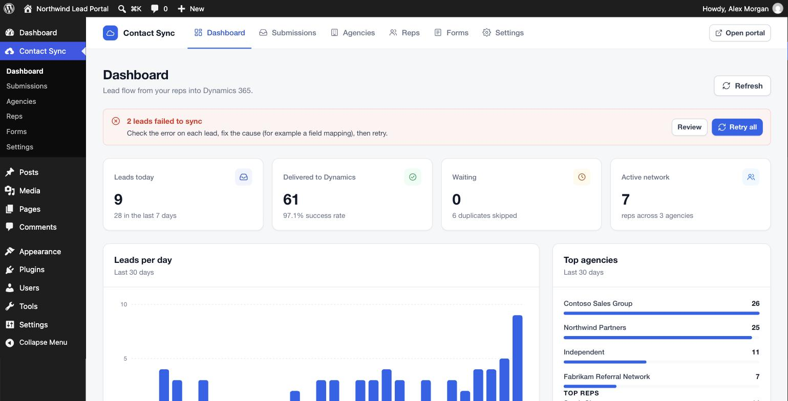
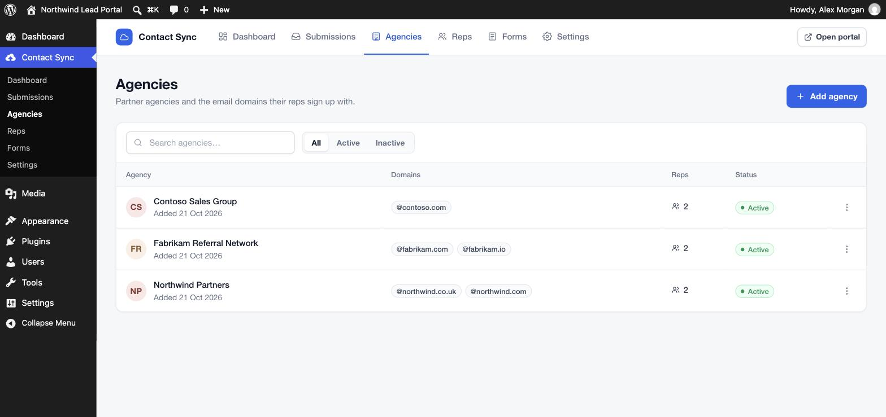
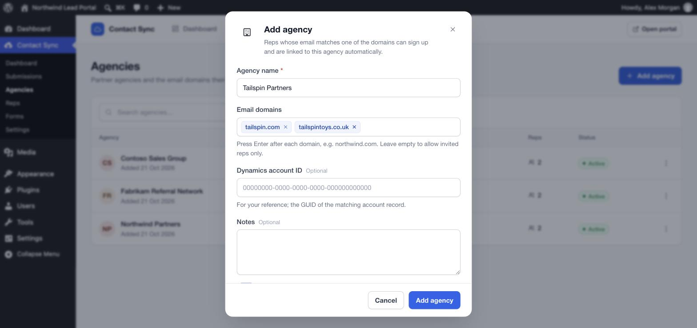
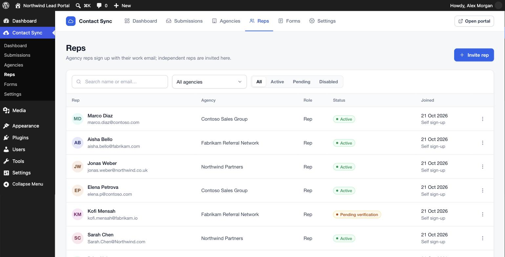
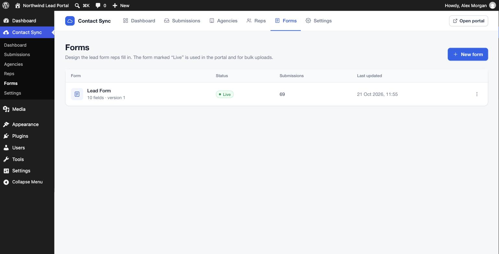
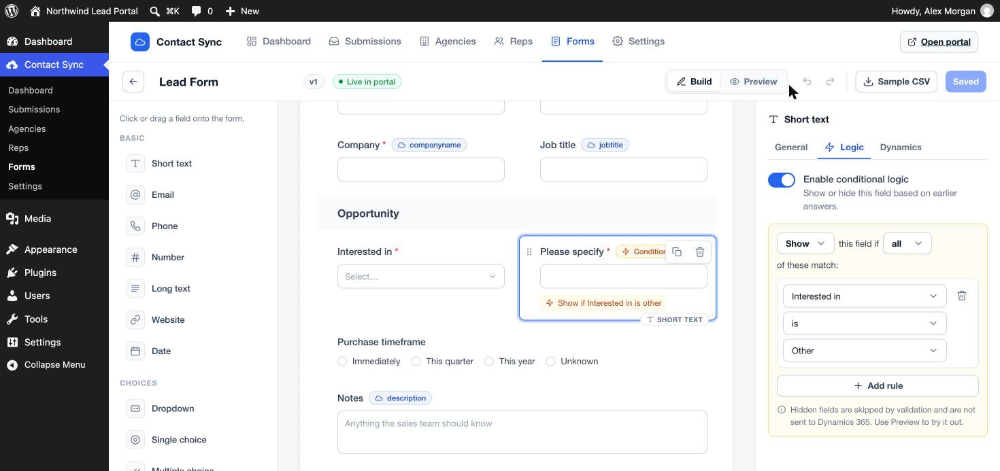
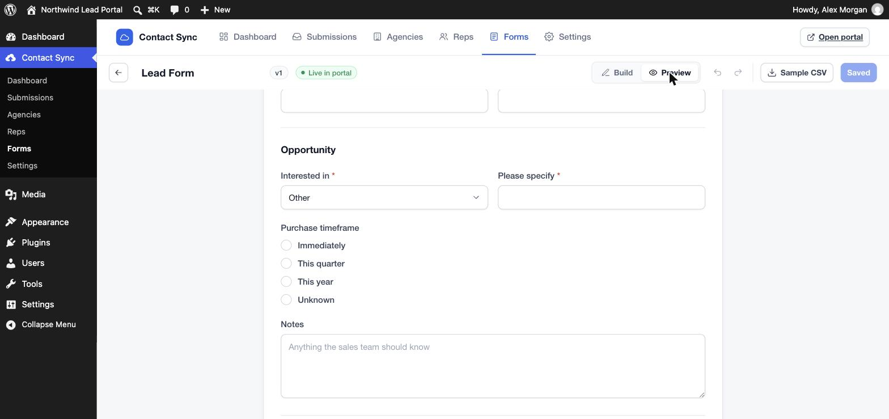
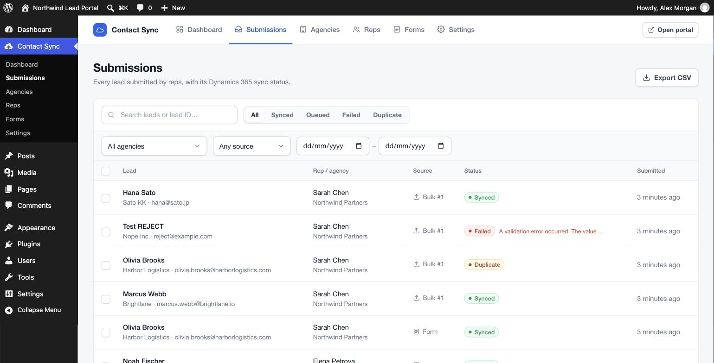

# Administrator guide

Everything is managed under **Contact Sync** in the WordPress admin. The top bar switches between Dashboard, Submissions, Agencies, Reps, Forms and Settings. **Open portal** shows the rep-facing app.

- [Dashboard](#dashboard)
- [Agencies](#agencies)
- [Reps](#reps)
- [Form builder](#form-builder)
- [Submissions](#submissions)
- [Settings](#settings)

## Dashboard

- **Setup checklist:** shown until Dynamics is connected and you have an agency, a rep and a first lead.
- **Alerts:** a red banner appears when leads failed to sync. **Review** opens them; **Retry all** re-queues them.
- **Tiles:** leads today and this week, how many reached Dynamics (with success rate), leads waiting, and the size of your rep network.
- **Leads per day:** the last 30 days. Hover a bar for the exact count.
- **Top agencies / Top reps:** submission counts for the last 30 days.
- **Latest submissions:** click a row to open it.

## Agencies

An agency is a partner company. Its **email domains** decide who may sign up: anyone with an email on one of those domains can create an account and is linked to that agency automatically.

### Add an agency

1. Click **Add agency**.
2. Enter the name.
3. Type each domain and press **Enter** (for example `northwind.com`). You can paste a list; `https://`, `www.` and `@` are removed for you.
4. Optionally add the Dynamics account ID and internal notes.
5. Click **Add agency**.

Rules:

- A domain can belong to only one agency.
- An agency with **no domains** is invite-only: reps can be assigned to it, but nobody can self-register.
- An **inactive** agency stops accepting new sign-ups. Existing reps keep their access.
- **Deleting** an agency makes its reps independent. Their submitted leads are kept.
- By default `sales.northwind.com` does **not** match `northwind.com`. Turn on **Settings › Security › Allow subdomains** to allow it.

## Reps

There are two ways reps get an account:

| | Agency reps | Independent reps |
| --- | --- | --- |
| How | Sign up themselves at `/signup` with their work email | You invite them |
| Agency | Detected from the email domain | None, or an agency you choose |
| Activation | Click the verification link in their email | Set a password from the invitation email |

### Invite a rep

1. Click **Invite rep**.
2. Enter name and email.
3. Choose **Independent**, or **Agency rep** and pick the agency.
4. Choose a role:
   - **Rep:** submits and tracks their own leads.
   - **Agency manager:** can also see every lead submitted by their agency (the **Agency leads** page in the portal) and disable or re-enable portal access for the reps in their agency (the **Team** page). The Reps list shows when a rep was disabled by their agency manager; if you change that rep's status yourself, the manager can no longer undo it. Every change is recorded in the Activity log.
5. Click **Send invitation**. The rep receives an email with a link to set their password. The link is valid for 24 hours; use **Resend invitation** if it expires.

### Row actions (⋮ menu)

- **Edit:** change name, agency or role. Choosing an agency here pins it, so it no longer changes automatically with the email domain.
- **Resend verification / invitation**
- **Mark as verified:** activate a pending sign-up without the email link.
- **Disable access / Enable access:** disabling signs the rep out everywhere and blocks sign-in.
- **Delete:** removes the account; their leads remain in Submissions.

Status badges: **Active**, **Pending verification** (signed up but has not clicked the link), **Disabled**.

## Form builder

**Forms** lists your lead forms. The one marked **Live** is the form reps see in the portal, and the one the CSV template and bulk upload follow. Use **⋮ › Make live in portal** to switch.

Open a form to edit it. The builder has three panels:

- **Left:** field types. Click one to add it below the selected field, or drag it to any position.
- **Centre:** the form. Drag the ⋮⋮ handle to reorder, hover a field to **duplicate** or **delete** it, and click a field to edit it. Badges show the Dynamics column and whether a field is conditional.
- **Right:** settings for the selected field, or form settings when nothing is selected.

Changes are saved only when you click **Save changes** (or press Ctrl/Cmd + S). **Undo/Redo** (Ctrl/Cmd + Z, Shift + Ctrl/Cmd + Z) covers all edits since the form was opened. Each save creates a new version, and each submission records the version it was made with.

### Field types

| Group | Types |
| --- | --- |
| Basic | Short text, Email, Phone, Number, Long text, Website, Date |
| Choices | Dropdown, Single choice, Multiple choice, Yes/No checkbox |
| Layout | Section heading, Divider |
| Advanced | Hidden value (e.g. a campaign code sent with every lead) |

### Field settings (General tab)

- **Label, Placeholder, Help text, Default value**
- **Options** (choice fields): label and value for each option. **Bulk edit** accepts one option per line, with `Label | value` to set a custom value.
- **Required**
- **Width:** full or half (two half-width fields sit side by side).
- **Validation:** min/max for numbers, and min/max length or a pattern for text fields (under *Advanced validation*).
- **Field key:** the CSV column name. It is created from the label for new fields. Avoid changing it once reps use spreadsheets.

### Conditional logic (Logic tab)

Show or hide a field, or a whole section, based on earlier answers.

1. Select the field and open **Logic**.
2. Turn on **Enable conditional logic**.
3. Choose **Show** or **Hide**, and whether **all** or **any** of the rules must match.
4. Add rules: *field*, *operator*, *value*. Only fields placed **above** this one can be used.

Operators:

| Field type | Operators |
| --- | --- |
| Dropdown / single choice | is, is not, is one of, is empty, is not empty |
| Multiple choice | contains, does not contain, is one of, is empty, is not empty |
| Yes/No checkbox | is checked, is not checked |
| Number | is, is not, is greater than, is less than, is empty, is not empty |
| Text | is, is not, contains, does not contain, is one of, is empty, is not empty |

Behaviour:

- A hidden field is **not required**, is **not validated** and its value is **discarded**. This is enforced on the server, so it also applies to bulk uploads.
- A condition on a **section heading** applies to every field until the next section.
- Comparisons ignore upper/lower case. "is one of" takes a comma-separated list.

Switch to **Preview** to try the form, including conditions and validation, without submitting anything.

### Mapping fields to Dynamics 365

In the **Dynamics** tab, pick the Lead column for the field. Standard columns are listed; choose **Custom column…** for your own columns and enter the logical name (for example `new_productinterest`) and type.

- **Text** columns receive the option *label* for choice fields.
- **Whole number / Choice** columns receive the option *value*. For Dynamics Choice (option set) columns, set each option's value to the numeric option value, such as `100000000`.
- **Yes / No** columns: use a Yes/No checkbox field.

With no field selected, the **Form settings** panel shows the full mapping and lets you add **fixed values** sent on every lead, for example `leadsourcecode = 8`.

## Submissions

- Search by name, email, company or Dynamics lead ID. Filter by status, agency, source (form or bulk) and date.
- Status:
  - **Queued:** waiting to be sent, or waiting for an automatic retry.
  - **Syncing:** being sent now.
  - **Synced:** created in Dynamics; the lead ID is shown.
  - **In review:** the email matches an earlier submission (or an earlier row in the same bulk upload), so the lead is held and not sent until you decide. Open it to see the earlier lead, then **Approve and send** or **Reject**. With the *In review* filter selected you can approve or reject several rows at once. Turn this off with **Hold duplicates for review** under Settings › Sync.
  - **Duplicate:** an open Lead with the same email already existed in Dynamics (only when Dynamics duplicate checking is on), or you rejected the lead from review.
  - **Failed:** Dynamics rejected it, or all retries were used. The error is shown.
- Click a row to see every answer, who submitted it, the Dynamics lead ID and the **sync history**. Each attempt shows the exact payload sent and the response under *Technical details*.
- **Retry sync** re-queues a lead (also available for several selected rows).
- **Export CSV** downloads the filtered list with all answers.
- **Delete** removes the record from WordPress only; it does not delete anything in Dynamics. With **soft delete** on (Settings › Data & logs), deleted leads go to **Trash** instead: they are hidden from reps, reports, duplicate checks and sync, and can be **restored** or **deleted permanently**. **Empty trash** deletes everything in it, and leads are removed automatically after the number of days you set.

## Activity log

The **Activity log** lists who did what and when: leads moved to the trash, restored or deleted permanently, emptying the trash, duplicate approvals and rejections, sync retries, rep invitations and changes (including disabling access), agency and form changes, settings changes (names only, never values) and the automatic clean-up. Filter by type, date or text, and click an entry to open the lead, form, agency list or rep list it refers to.

## Settings

| Tab | What it controls |
| --- | --- |
| Dynamics 365 | Connection details and **Test connection** ([setup guide](dynamics-setup.md)) |
| Sync | Pause or resume sync, duplicate handling, number of retries, Topic template, agency/rep columns on the Lead, adding details to the description, **Sync queued leads now** |
| Branding | Product name, tagline, logo, brand colour and support email used across the portal and emails |
| Emails | Sender name and address, subject and text of the verification, invitation and password-reset emails, **Send test email** |
| Data & logs | **Soft delete** (move deleted leads to Trash), days before the trash is emptied, and how long the Activity log and per-lead sync history are kept (0 keeps them forever). Clean-up runs once a day |
| Security | Sign-in lockout (attempts and minutes), subdomain matching, bulk upload limits (rows and file size) |

Always-on protections: email verification for sign-ups, rate-limited sign-up, sign-in and password reset, an encrypted CRM secret, the public-site lockdown and disabled XML-RPC.
