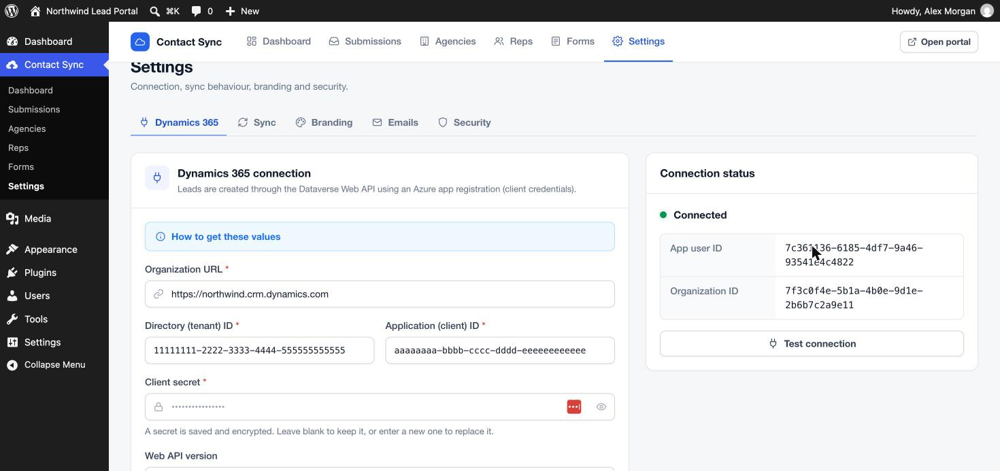

# Connecting Dynamics 365

Contact Sync creates Leads through the Dataverse Web API. It signs in as an **application user** using an Azure app registration, so no person's password is stored and access can be revoked at any time.

You need admin rights in Microsoft Entra ID (Azure AD) and in the Power Platform admin center. It takes about 10 minutes.

## 1. Register an app in Microsoft Entra ID

1. Open the [Azure portal](https://portal.azure.com) › **Microsoft Entra ID** › **App registrations** › **New registration**.
2. Name: `Lead Portal` (any name). Supported account types: **Single tenant**. Leave Redirect URI empty. Click **Register**.
3. On the overview page copy:
   - **Application (client) ID**
   - **Directory (tenant) ID**

## 2. Create a client secret

1. In the app registration open **Certificates & secrets** › **Client secrets** › **New client secret**.
2. Choose an expiry (e.g. 24 months) and click **Add**.
3. Copy the secret **Value** immediately. It is shown only once.

> Put a reminder in your calendar before the secret expires. When it does, leads stop syncing with an "Authentication failed" error until you enter a new one.

No API permissions need to be added in Azure. Access is granted in Dynamics in the next step.

## 3. Create the application user in Dynamics 365

1. Open the [Power Platform admin center](https://admin.powerplatform.microsoft.com) › **Environments** › your environment › **Settings** › **Users + permissions** › **Application users**.
2. Click **New app user** › **Add an app** and pick the app you registered.
3. Choose the **Business unit**.
4. Under **Security roles** assign a role that can create and read Leads, for example **Salesperson**, or a custom role with *Create* and *Read* on Lead.
5. Click **Create**.

## 4. Find your organization URL

In the Power Platform admin center open the environment. The **Environment URL** looks like `https://yourorg.crm.dynamics.com` (the region suffix may be `crm4`, `crm11`, and so on).

## 5. Enter the values in WordPress

Go to **Contact Sync › Settings › Dynamics 365** and fill in:

| Field | Value |
| --- | --- |
| Organization URL | `https://yourorg.crm.dynamics.com` |
| Directory (tenant) ID | from step 1 |
| Application (client) ID | from step 1 |
| Client secret | from step 2 |
| Web API version | `v9.2` (default) |

Click **Save and test connection**. A green **Connected** status shows the application user ID and organization ID.

The secret is encrypted before it is stored, using keys from your `wp-config.php`, and is never shown again. To replace it, type a new one. Leaving the field blank keeps the current secret.

## 6. Map form fields to Lead columns

Each field in the lead form can be mapped to a Lead column (see [Form builder › Dynamics tab](admin-guide.md#mapping-fields-to-dynamics-365)). The starter form is already mapped to the standard columns:

| Form field | Lead column |
| --- | --- |
| First name | `firstname` |
| Last name | `lastname` |
| Email | `emailaddress1` |
| Phone | `telephone1` |
| Company | `companyname` |
| Job title | `jobtitle` |
| Notes | `description` |

Fields that are not mapped are added to the lead's **Description**, together with "Submitted via … by *rep* (*email*), *agency*", so no information is lost.

### Recording the agency and rep on the Lead

To report on leads by agency, create text columns on the Lead table (for example `new_agency`, `new_repname`, `new_repemail`) in Power Apps, then enter their logical names under **Settings › Sync › Attribution**.

### Topic (subject)

Dynamics requires a Topic on each Lead. If no field maps to `subject`, Contact Sync builds one from the template in **Settings › Sync**. The default is `Lead from {agency} - {rep}`.

## Sovereign clouds

For US Government (GCC High) environments the token endpoint is `login.microsoftonline.us`. A developer can switch it with the `contact_sync_token_url` filter (see [Developer reference](developer.md)).
