# Rep guide

This guide is for the reps who submit leads. Share it, or the relevant section, with your partners.

## Create your account

### If your agency is a registered partner

1. Go to your portal address, e.g. `https://leads.example.com/signup`.
2. Enter your name, your **work email** and a password (at least 8 characters, with letters and numbers).
3. Click **Create account**.
4. Open the email titled **Confirm your email** and click **Confirm email address**. The link is valid for 48 hours.
5. Sign in. Your agency is filled in automatically from your email address.

If you see *"Sign up is only available for approved partner email domains"*, your company's domain is not registered yet. Ask your partner manager to add it, or to invite you directly.

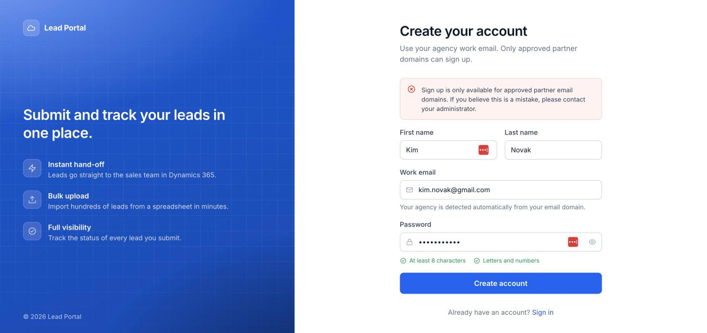

### If you were invited

Open the invitation email, click **Set your password**, choose a password and sign in.

## Sign in

Go to `/login` and use your email and password. Forgot it? Click **Forgot password?** to get a reset link by email.

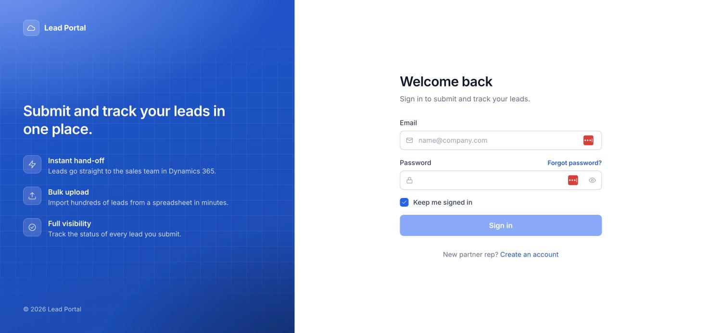

## Dashboard

Shows how many leads you have submitted, how many reached the sales team, anything still in progress, a chart of the last 14 days and your most recent leads.

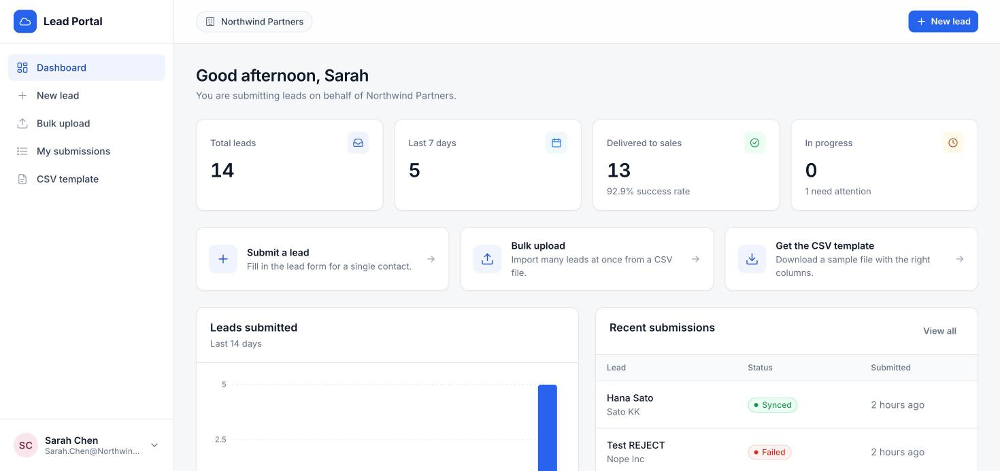

The badge at the top shows the agency your leads are credited to (or **Independent rep**).

## Submit a single lead

1. Click **New lead**.
2. Fill in the form. Required fields are marked with a red \*. Some questions appear only when relevant; for example, choosing **Other** asks you to specify.
3. Click **Submit lead**.

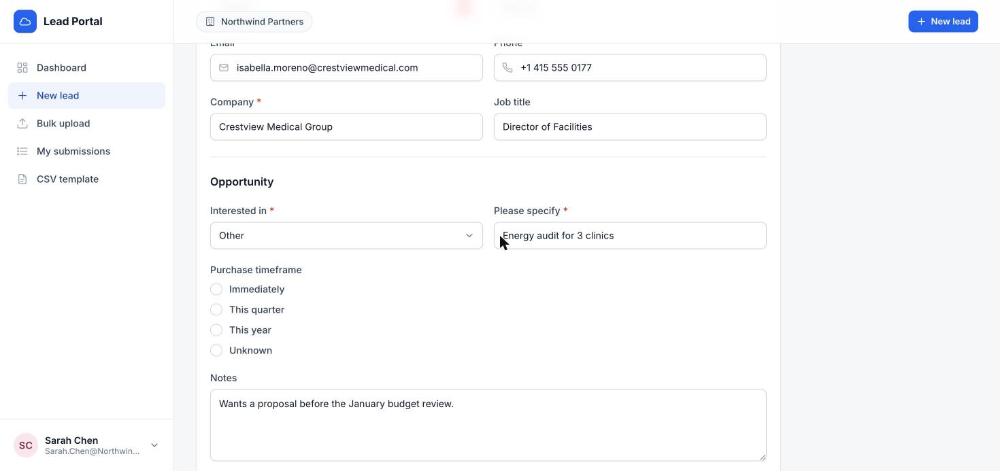

The confirmation screen shows the delivery status, which updates automatically:

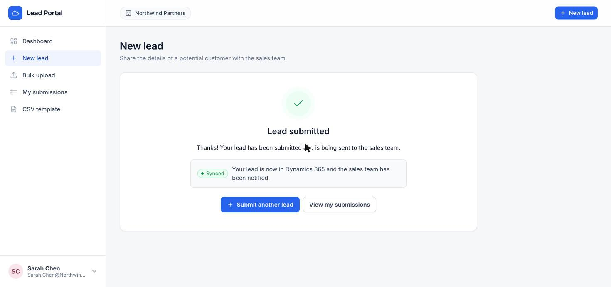

## Upload many leads from a spreadsheet

### 1. Get the template

Open **CSV template** and click **Download template**. The file always matches the current form. The **Column reference** explains each column and the accepted values.

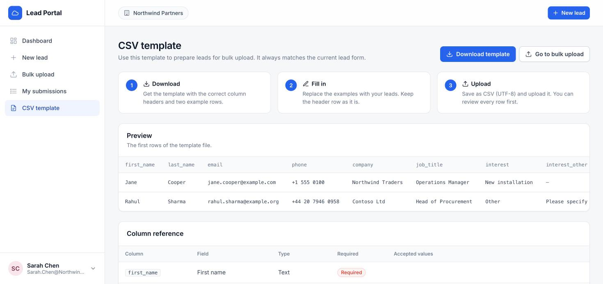
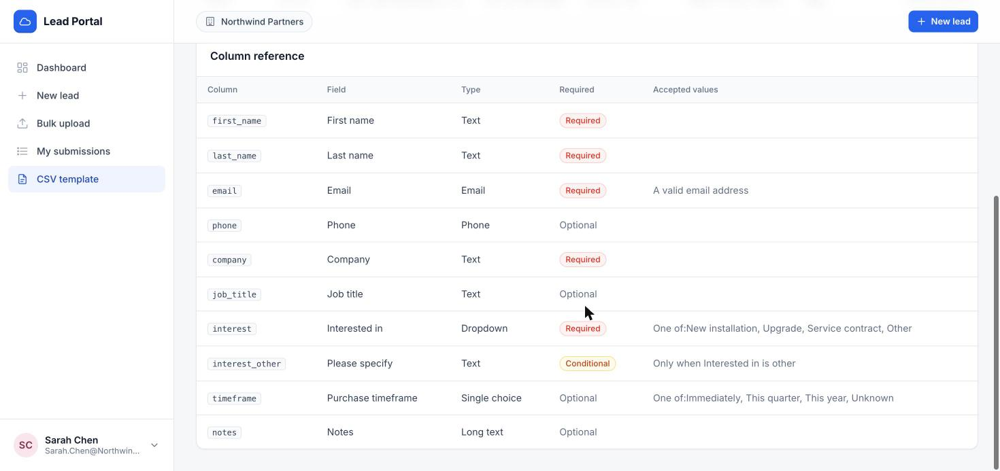

Tips for filling it in:

- Keep the header row.
- For dropdown and choice columns, type the option exactly as listed (upper/lower case does not matter).
- For multiple-choice columns separate values with `;` (for example `Email; Phone`).
- For yes/no columns use `yes` or `no`.
- Dates: `YYYY-MM-DD` is safest; most common formats are understood.
- Save as **CSV UTF-8** (in Excel: *File › Save As › CSV UTF-8*).

### 2. Upload

Open **Bulk upload** and drag your file onto the box (or click to choose it).

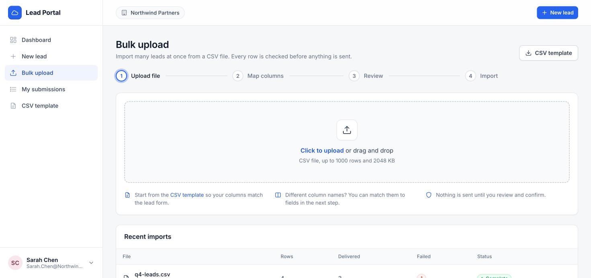

### 3. Match columns

Columns are matched to form fields automatically by name. Check the matches and adjust any that are wrong.

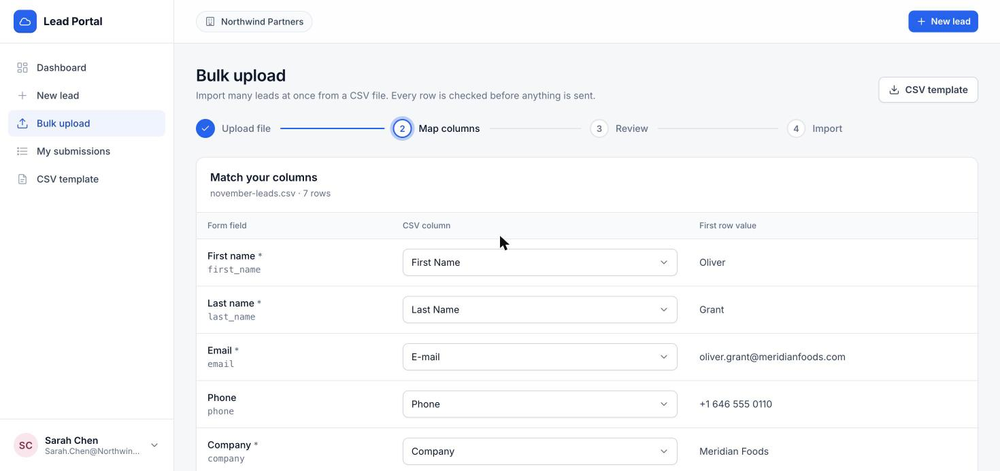

### 4. Review

Every row is checked before anything is sent. Rows with problems are listed with the reason. Click **Download rows with errors** to get a file you can fix and upload later. The valid rows can be imported straight away.

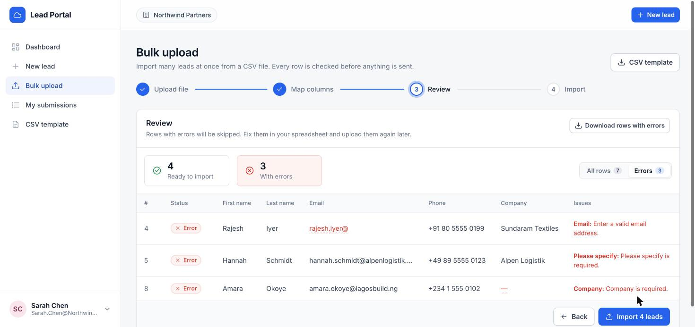

### 5. Import

Click **Import N leads**. A progress screen shows them being delivered.

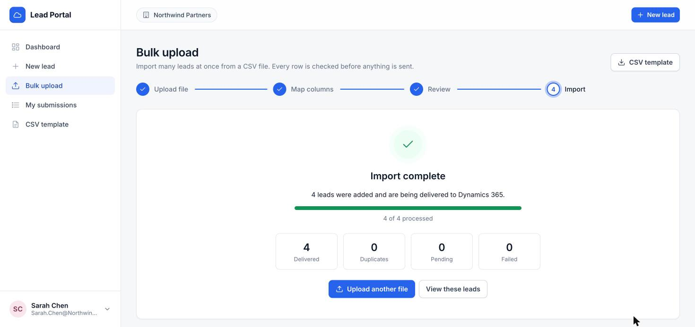

## Track your leads

**My submissions** lists every lead with its status. Click a lead to see what you submitted.

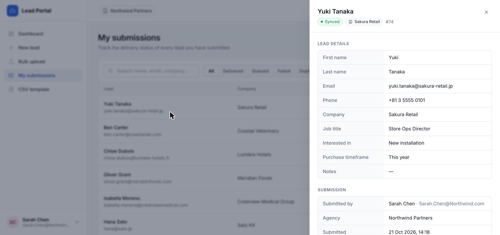

| Status | Meaning |
| --- | --- |
| Queued | Waiting to be sent (usually seconds) |
| Syncing | Being sent now |
| Delivered / Synced | The sales team has it |
| Duplicate | This contact was already an open lead, so no copy was created |
| Failed | It could not be delivered automatically; the admin team has been alerted |

**Agency managers** also get an **Agency leads** page listing every lead from their agency.

## On your phone

The portal works on mobile. Use the ☰ button to open the menu.

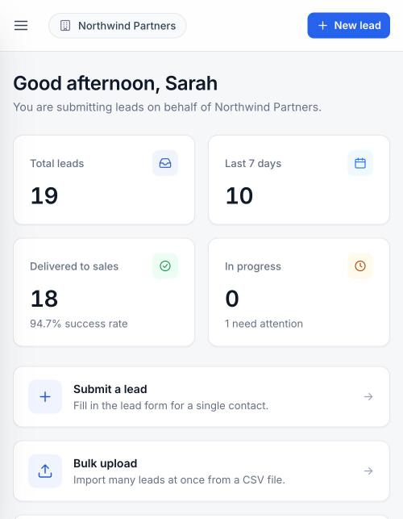
